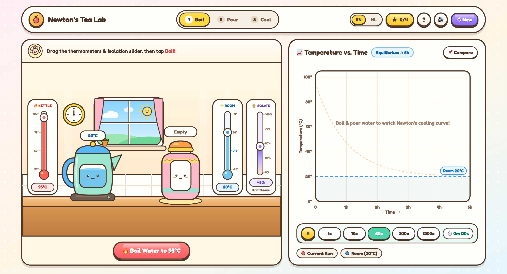

# 🫖 Newton’s Tea Lab (*Newtons Theelab*)

An interactive, zero-dependency static web game that teaches **Newton’s Law of Cooling** (and water’s **0°C freezing/melting enthalpy plateau**) in a playful, cozy iPad-style kitchen lab.

👉 **Play live:** [https://wouteronarchitecture.com/newtons-tea-lab/](https://wouteronarchitecture.com/newtons-tea-lab/)



## ✨ Features

- **Boil → Pour → Cool loop:** Heat water in the kettle to any target temperature (`25°C – 100°C`), drag or tap to pour it into the thermos flask, and watch it cool (or warm!) toward room temperature.
- **In-scene interactive controls:** Drag the tall vertical sliders right inside the kitchen scene to tune:
  - **🔥 Kettle Temperature** (`25°C` to `100°C`)
  - **🌤️ Room Temperature** (`-20°C` to `40°C`, with live weather & window changes)
  - **🧥 Isolation Factor** (`0%` Thin Tin → `100%` Vacuum Shield, dynamically changing the thermos look and cooling constant $k$)
- **Real-time Temperature vs. Time graph:**
  - Automatically calculates and locks the time axis to the predicted **time to equilibrium** on pour so curves stay easy to read without rescaling.
  - Shows the room-temperature asymptote, a **❄️ 0°C Freezing Point** guide line when sub-zero, and lets you **📌 Compare** up to 4 pinned runs side-by-side.
  - Time speed controls (`1×` to `1200×` + pause/play) built directly into the graph panel.
- **🧊 0°C Freezing & Melting Enthalpy Plateau:** Cool water in a sub-zero room (`-20°C` to `-1°C`) and watch the temperature hold flat at `0°C` while releasing water’s latent heat of fusion before solid ice cools ~2× faster toward equilibrium.
- **🌐 Bilingual (`EN | NL`):** Instant top-bar toggle between **English** and **Nederlands (Vlaams)**, persisted in `localStorage`.
- **⭐ Discovery Missions & Procedural Web Audio:** 4 built-in science challenges and synthesized kettle, pouring, and UI sound effects — no external audio files or build step needed.

## 🧪 Physics Model

Liquid cooling and warming follow the exact analytical solution to Newton’s Law of Cooling:

$$\frac{dT}{dt} = -k \,(T - T_{\text{room}}) \quad\Longrightarrow\quad T(t + \Delta t) = T_{\text{room}} + (T(t) - T_{\text{room}})\,e^{-k\,\Delta t}$$

When water reaches $0^\circ\text{C}$ in a sub-zero room (or ice melts in a warm room), heat continues flowing at rate $-k\,(0 - T_{\text{room}})$ while temperature stays flat at $0^\circ\text{C}$ across water’s latent-heat equivalent ($L_f / c_{\text{water}} \approx 79.8^\circ\text{C}$). Once fully frozen, solid ice cools with $k_{\text{ice}} = 2k$ ($c_{\text{ice}} \approx 0.5\,c_{\text{water}}$).

## 🚀 Run Locally

This is a 100% static site (HTML, CSS, vanilla JS, SVG, and Canvas) with zero build tools or dependencies:

```bash
git clone https://github.com/woutervanranst/newtons-tea-lab.git
cd newtons-tea-lab
open index.html
```

Or serve it with any local static server (e.g. `python3 -m http.server`).

## 📄 License

Licensed under [CC BY-NC 4.0](LICENSE).
